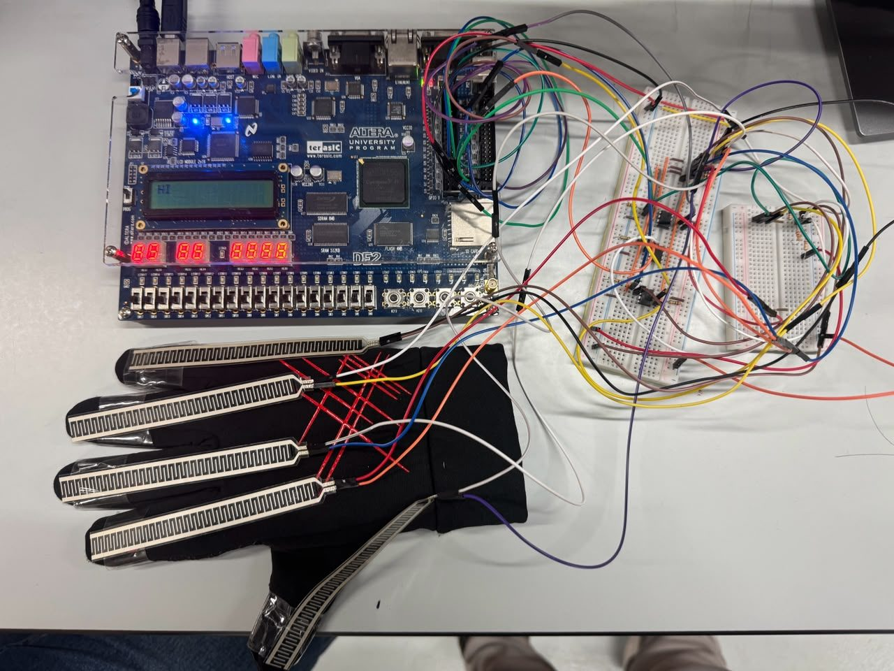
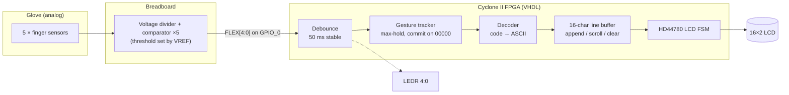
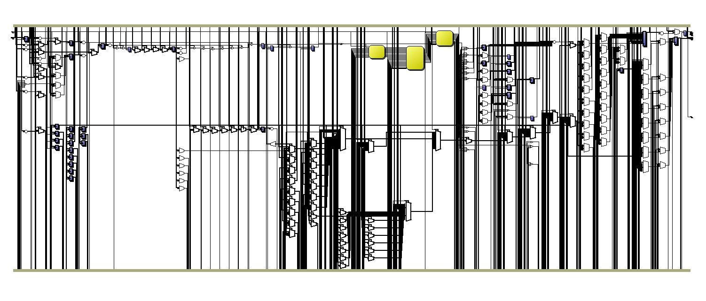
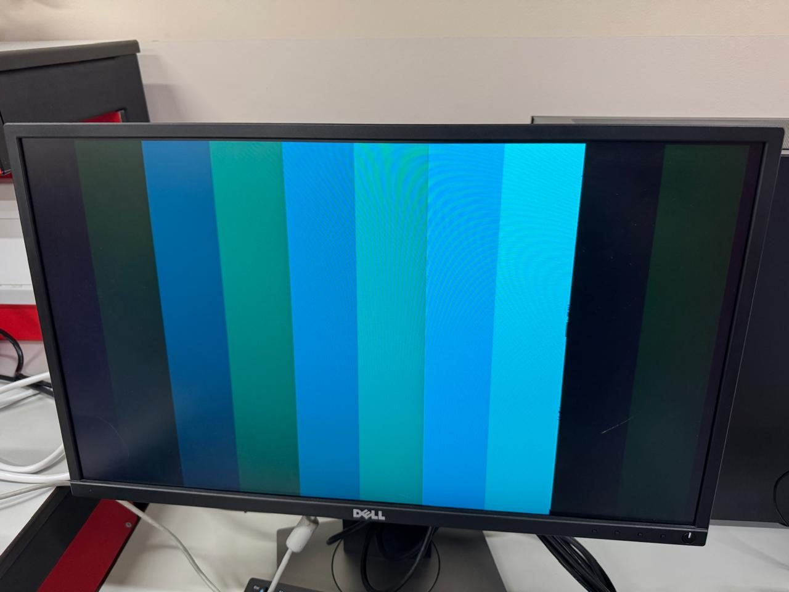
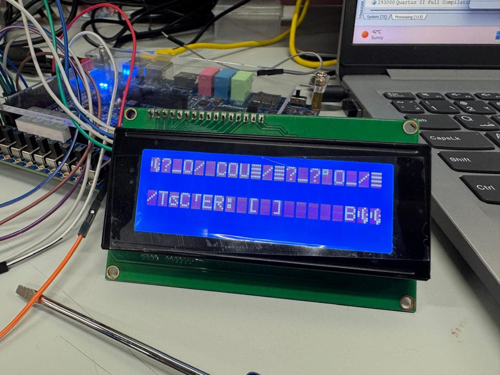
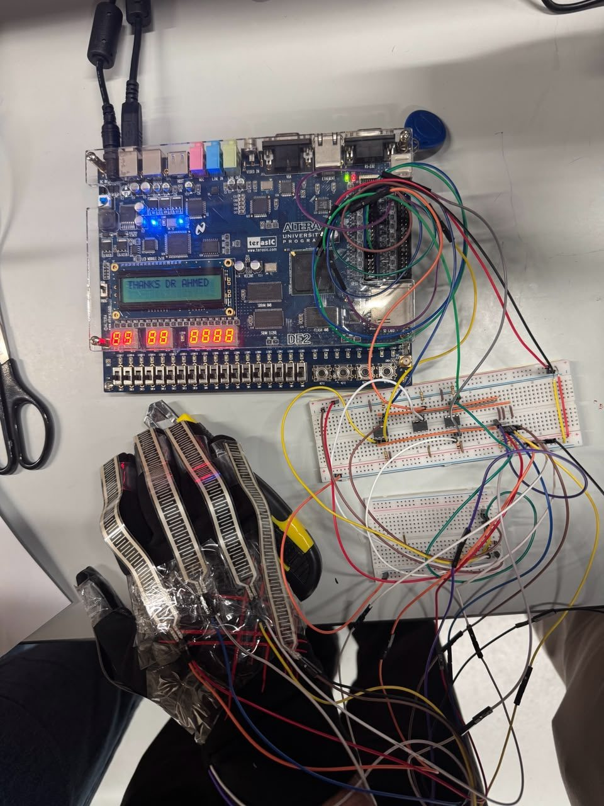

# FPGA Sign-Language Glove

**A wearable glove with five finger sensors that spells A–Z on an LCD in real time. All gesture logic runs in VHDL on a Cyclone II FPGA, with no microcontroller or PC in the loop.**

<p align="center">
  
  <br><em>Glove → comparator stage → DE2 (Cyclone II). The LCD shows a word spelled with the glove.</em>
</p>

---

## Overview

People who use sign language often struggle to communicate with people who don't know it. Camera-based recognition is the usual approach, but it needs a camera, a processor and controlled lighting. This project takes a lower-cost, deterministic route: a glove with one sensor per finger, an analog comparator stage, and an FPGA. The FPGA turns finger combinations into letters and builds a phrase on the board's LCD.

The goal was low-latency, fully hardware-based recognition. Every stage is clocked logic on the FPGA, so the response time is fixed and doesn't depend on software scheduling.

## Features

- Full A–Z alphabet from one hand: the five sensor bits form a binary code where 1–26 = A–Z, 31 = space and 30 = clear ([truth table](docs/truth-table.md))
- 50 ms debounce on the sensor inputs
- Letters are committed when the hand opens, so fingers can bend in any order without printing wrong letters along the way
- 16-character line that scrolls left when full
- LCD driver written from scratch as a VHDL state machine (no IP cores)
- `LEDR[4:0]` show the raw state of each sensor for debugging
- Uses 457 logic elements, about 1% of the EP2C35

## How It Works



1. **Sensing.** Each finger sensor sits in a voltage divider. A comparator checks its voltage against a reference (VREF) and outputs a clean logic 0 or 1. I modeled the threshold in Tinkercad before wiring it, then calibrated it on the glove.
2. **Debounce.** The 5-bit input must hold steady for 2,500,000 clock cycles (50 ms at 50 MHz) before the FPGA accepts it.
3. **Gesture tracking.** While any finger is active, the FPGA keeps the numerically largest code seen. Bits are only added as fingers close, so this captures the full gesture. When the hand returns to `00000`, the stored code is committed.
4. **Decoding and buffering.** The code is converted to ASCII and written to a 16-character buffer. Code `11111` adds a space and `11110` clears the line.
5. **Display.** The LCD state machine redraws the line whenever the buffer changes. It uses a toggle handshake between the two processes, so an update made mid-write is never lost.

<p align="center">
  
  <br><em>RTL view of the synthesized design (Quartus II).</em>
</p>

### Design Iterations

| Iteration | Outcome |
|---|---|
| Camera → VGA on FPGA | Abandoned: the output was about ten vertical blue bands instead of an image (pixel timing and synchronization) |
| USB webcam | Rejected: it would need an Arduino in between, and the brief required a standalone FPGA system |
| Flex sensors + external LCD (Cyclone V) | LCD showed scrambled characters, so I moved to the DE2's built-in LCD |
| Flex sensors → pressure sensors | Pressure sensors gave a faster, more stable digital output |
| Word dictionary (v1) → letter spelling (final) | 16 fixed words became an open A–Z alphabet with debounce and commit-on-release ([history](docs/history/)) |

<p align="center">
  
  
  <br><em>Left: failed camera → VGA attempt. Right: scrambled external LCD on the Cyclone V. Both led to the final design.</em>
</p>

## Tech Stack

| Layer | Tools |
|---|---|
| HDL | VHDL (IEEE `std_logic_1164`, `numeric_std`) |
| FPGA | Terasic DE2, Altera Cyclone II EP2C35F672C6, 50 MHz |
| Toolchain | Quartus II 13.0 SP1 Web Edition (the last version that supports Cyclone II), USB-Blaster |
| Analog front-end | Finger sensors, voltage dividers, comparators with a VREF threshold |
| Circuit simulation | Tinkercad |
| Display | On-board 16×2 HD44780-compatible character LCD |

## Results

The final prototype recognized all 26 letters plus the space and clear commands, matching the truth table in hardware tests. Gestures performed in sequence built readable phrases on the LCD.

<p align="center">
  
  <br><em>A 15-character phrase spelled gesture by gesture (<a href="docs/truth-table.md#example-spelling-thanks-dr-ahmed">sequence</a>).</em>
</p>

| Metric | Value | Source |
|---|---|---|
| Symbols supported | 26 letters + space + clear | Truth table, hardware test |
| Logic elements | 457 / 33,216 (1%) | Quartus fitter report |
| Registers | 216 | Quartus fitter report |
| I/O pins | 24 / 475 (5%) | Quartus fitter report |
| Memory bits / multipliers / PLLs | 0 / 0 / 0 | Quartus fitter report |
| Fmax (slow model) | 199.8 MHz (requirement: 50 MHz) | TimeQuest |
| Debounce window | 50 ms | Design constant |
| LCD full-line redraw | ≈ 2.9 ms | Calculated from FSM delays |

> Debounce and redraw times are calculated from the design's timing constants, not measured on hardware. Per-user recognition accuracy was not formally measured; see [Limitations](#limitations-and-future-work).

## Getting Started

### Requirements

- Terasic **DE2** board (Cyclone II EP2C35F672C6)
- **Quartus II 13.0 SP1 Web Edition** (free; newer Quartus versions don't support Cyclone II) and the USB-Blaster driver
- Glove front-end: 5 finger sensors, each with a voltage divider and a comparator, giving **3.3 V logic** outputs

### Wiring

| Signal | FPGA pin | DE2 location |
|---|---|---|
| `FLEX[0]` Thumb | PIN_D25 | GPIO_0[0] |
| `FLEX[1]` Index | PIN_J22 | GPIO_0[1] |
| `FLEX[2]` Middle | PIN_E26 | GPIO_0[2] |
| `FLEX[3]` Ring | PIN_E25 | GPIO_0[3] |
| `FLEX[4]` Pinky | PIN_F24 | GPIO_0[4] |
| Comparator ground | GND | GPIO_0 GND pin |

LCD, LED and clock pins are already assigned in [`quartus/fpgatest.qsf`](quartus/fpgatest.qsf).

> **Note:** DE2 GPIO pins are 3.3 V. Don't feed 5 V comparator outputs straight in. Power the comparators from 3.3 V or use an open-collector comparator with a pull-up to 3.3 V.

### Build and Program

```bash
git clone https://github.com/AbdelrahmanSotohy/fpga-sign-language-glove.git
cd fpga-sign-language-glove/quartus
```

**GUI:** open `quartus/fpgatest.qpf` in Quartus II 13.0 SP1 → **Processing → Start Compilation** → **Tools → Programmer** → select `output_files/fpgatest.sof` → **Start**.

**Command line** (with Quartus on your `PATH`):

```bash
quartus_sh --flow compile fpgatest
quartus_pgm -m jtag -o "p;output_files/fpgatest.sof"
```

### Usage

1. Power up. The LCD initializes and shows a blank line.
2. Form a finger combination from the [truth table](docs/truth-table.md) and hold it for at least 50 ms.
3. **Open your hand.** The letter appears.
4. Make a closed fist and release to add a space. Close all fingers except the thumb and release to clear the line.

## Project Structure

```
fpga-sign-language-glove/
├── rtl/
│   └── fpgatest.vhd          # Top-level design: debounce, gesture logic, LCD driver
├── quartus/
│   ├── fpgatest.qpf          # Quartus project
│   ├── fpgatest.qsf          # Device and pin assignments
│   └── fpgatest.sdc          # 50 MHz clock constraint
├── docs/
│   ├── truth-table.md        # Full 32-code mapping + example phrase
│   └── history/
│       ├── README.md         # Design evolution notes
│       └── v1_word_mode.vhd  # First prototype (word dictionary)
├── assets/                   # Photos and figures used in this README
├── LICENSE
└── README.md
```

## Limitations and Future Work

Limitations:

- Each finger is just on or off, with a threshold set by hand using VREF. Different users and glove fits need recalibration.
- The 5-bit alphabet is a custom code, not real sign language. Real fingerspelling also depends on hand shape, orientation and motion (J and Z move).
- Only the first LCD row is used, and text isn't saved.
- Sensor inputs have no two-flop synchronizer before the debounce logic.
- Clear (11110) and space (11111) differ only by the thumb, so they're easy to mix up.
- Accuracy wasn't measured across users.

Next steps I'd like to try:

- Replace the comparators with an ADC and use the actual bend levels (plus an IMU for motion) as input to a small quantized classifier on the FPGA, so it can recognize real fingerspelling
- Automatic calibration per user at startup
- Collect a labeled dataset from several users and report per-letter accuracy and latency
- Add an input synchronizer, use both LCD lines, and add a backspace gesture

## Team and Credits

Course project for **CEN 466 – Advanced Digital System Design**, Abu Dhabi University, Spring 2026.

**Team:** Abdelrahman Sotohy, Jouni Ilyas, Mohammad Nader

**Instructor:** Dr. Ahmed Ali

## Contact

Abdelrahman Sotohy, Computer Engineering, Abu Dhabi University

[LinkedIn](https://www.linkedin.com/in/abdelrahman-sotohy-6986b8369/) · [GitHub](https://github.com/AbdelrahmanSotohy)

## License

The code is released under the [MIT License](LICENSE).
